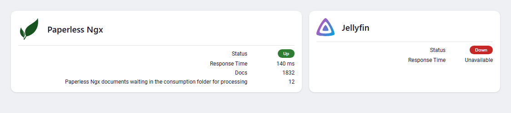

# Homelab Service Card

[](https://hacs.xyz/docs/faq/custom_repositories)
[](../../actions/workflows/validate.yml)

A Home Assistant dashboard card that shows a service running in your homelab:
its icon, its name (both link to the service), an **Up / Down** status pill and
any number of extra entities such as response time.



## Features

- Icon and name link to your service (opens in a new tab by default).
- Status entity shown as a green **Up** or red **Down** pill.
- Any number of additional entities, one per line, with name and value.
  Each entity can have its own display name. Long names stay on one line and are shortened with "…".
- Full width in sections dashboards by default (resizable in the layout editor).
- Click a row to open the entity's more-info dialog.
- Fully configurable in the visual editor, no YAML needed.
- Works with icons from [selfh.st/icons](https://selfh.st/icons/), any image URL, or `mdi:` icons.

## Installation

### HACS (recommended)

1. Open **HACS** in Home Assistant.
2. Open the menu (⋮) → **Custom repositories**.
3. Add this repository's URL with type **Dashboard**.
4. Search for **Homelab Service Card** and click **Download**.
5. Reload your browser.

### Manual

1. Download `homelab-service-card.js` from the [latest release](../../releases/latest).
2. Copy it to `config/www/homelab-service-card.js`.
3. Go to **Settings → Dashboards → ⋮ → Resources** and add
   `/local/homelab-service-card.js` as a **JavaScript module**.
4. Reload your browser.

## Configuration

Add the card from the dashboard editor (search for *Homelab Service Card*)
and configure everything in the visual editor. Or use YAML:

```yaml
type: custom:homelab-service-card
name: Paperless Ngx
url: https://paperless.example.com
icon: https://cdn.jsdelivr.net/gh/selfhst/icons/svg/paperless-ngx.svg
icon_size: 48
status_entity: binary_sensor.paperless_status
entities:
  - sensor.paperless_response_time
  - entity: sensor.paperless_documents
    name: Documents
```

| Option            | Type    | Default  | Description                                                                                     |
| ----------------- | ------- | -------- | ----------------------------------------------------------------------------------------------- |
| `name`            | string  |          | Service name shown next to the icon.                                                            |
| `url`             | string  |          | Opened when clicking the icon or name. Paths starting with `/` navigate inside Home Assistant.  |
| `open_in_new_tab` | boolean | `true`   | Open external URLs in a new browser tab.                                                        |
| `icon`            | string  |          | Image URL (e.g. from [selfh.st/icons](https://selfh.st/icons/)) or an `mdi:` icon.              |
| `icon_size`       | number  | `48`     | Icon size in pixels. The icon is shown as a square.                                             |
| `status_entity`   | entity  |          | Entity for the service state, shown as the first row with an Up / Down pill.                    |
| `status_label`    | string  | `Status` | Label of the status row.                                                                        |
| `entities`        | list    | `[]`     | Additional entities, one per line. Each item is an entity ID or `{ entity, name }`, where `name` overrides the displayed name. |

### Up / Down states

The status entity counts as **Up** when its state is one of `on`, `up`, `online`,
`connected`, `running`, `ok`, `true`, `home`, `available` or `1`. Every other
state, including `unavailable`, counts as **Down**.

This works out of the box with `binary_sensor` connectivity entities (for example
from the [Uptime Kuma](https://www.home-assistant.io/integrations/uptime_kuma/)
or [Ping](https://www.home-assistant.io/integrations/ping/) integrations) and
with sensors reporting `up` / `down`.

### Icons

[selfh.st/icons](https://selfh.st/icons/) hosts icons for most self-hosted apps.
Use the CDN URL in SVG, PNG or WebP format:

```text
https://cdn.jsdelivr.net/gh/selfhst/icons/svg/<app-name>.svg
https://cdn.jsdelivr.net/gh/selfhst/icons/png/<app-name>.png
```

## Development

The card is a single dependency-free JavaScript file,
[`dist/homelab-service-card.js`](dist/homelab-service-card.js). There is no build step.

- Open [`demo/index.html`](demo/index.html) in a browser to preview the card with sample data.
- To test in Home Assistant, copy the file to `config/www/` and add it as a resource (see *Manual* above).

### Releasing

1. Bump `CARD_VERSION` in `dist/homelab-service-card.js`.
2. Commit, then create a GitHub release with a tag like `v0.1.0`.
3. The release workflow attaches `homelab-service-card.js` to the release, and HACS picks it up.

## License

[MIT](LICENSE)
